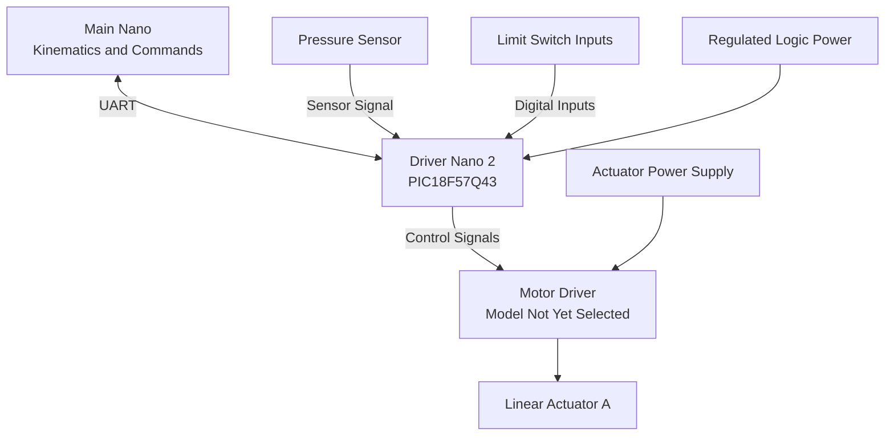

# Individual Block Diagram

## Overview

My assigned subsystem is Driver Nano 2 for Team 102's robotic spider leg.

The purpose of this block diagram is to show how my microcontroller communicates with the main controller and connects to the actuator, pressure sensor, limit switches, and power system.

The design uses a PIC18F57Q43 Curiosity Nano development board.

## Subsystem Block Diagram

The following diagram shows the proposed functional connections. It is a planning diagram, not a finalized wiring schematic.

*Figure 1. Proposed Driver Nano 2 functional block diagram.*

## Controller

The PIC18F57Q43 Curiosity Nano is the controller for my subsystem.

Its planned responsibilities include:

- Receiving commands through UART
- Processing actuator movement requests
- Monitoring limit switches
- Reading the pressure sensor
- Controlling the actuator driver
- Returning status and sensor data

## Linear Actuator Control

Linear Actuator A is used to move one of the robotic leg joints.

The actuator will require a suitable driver because the PIC cannot directly supply the motor's operating current.

The driver must support the selected actuator's voltage, current, and required direction control.

The final driver and actuator models have not been confirmed.

## Pressure Sensor

The pressure sensor is intended to provide information about contact or applied force at the leg.

The sensor's output type must be checked before it is connected to the PIC.

If the selected sensor provides an analog voltage, an appropriate ADC input can be used, provided the signal remains within the PIC's permitted input range.

## Limit Switches

The team plans to use two limit switches per joint.

My controller will monitor the limit switches assigned to my actuator.

The proposed behavior is to stop movement farther into an activated travel limit while allowing safe movement away from the limit when appropriate.

The final wiring and input configuration will depend on the selected switches and safety design.

## Communication With Main Nano

The team has selected UART for communication between controllers.

The main Nano will send movement commands to Driver Nano 2.

Driver Nano 2 will return relevant sensor readings, limit status, and fault information.

The final message format, pin assignments, baud rate, and communication wiring are still being defined.

## Power Connections

The design separates the microcontroller's regulated logic supply from the actuator's higher-current power path.

Both systems must use compatible signal references and a properly designed grounding arrangement.

Final voltage and current requirements cannot be determined until the actuator and driver are selected.

## Design Requirements

| Requirement | Planned Design Feature |
|---|---|
| Control joint movement | Linear actuator and motor driver |
| Receive movement commands | UART interface |
| Monitor travel limits | Limit-switch inputs |
| Detect pressure or contact | Pressure sensor |
| Report subsystem status | UART feedback |
| Supply appropriate power | Logic and actuator power distribution |

## Design Status

This block diagram describes the planned subsystem architecture.

The final schematic will identify specific component models, pin assignments, power connections, protection devices, and connector details.

No complete subsystem test results are available yet.
