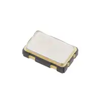

# Component Selection

## Overview

This page documents the component choices and selection criteria for Driver Nano 2.

My subsystem must control Linear Actuator A, read a pressure sensor, monitor limit switches, and communicate with the main controller.

The final actuator, driver, and pressure sensor models have not been confirmed. The tables below explain the requirements and tradeoffs rather than presenting unverified parts as selected.

## Microcontroller Selection

### PIC18F57Q43 Curiosity Nano

**Current selection:** PIC18F57Q43 Curiosity Nano development board.

The team is using PIC18F57Q43-based development boards for its distributed control architecture.

This board provides the embedded processing and peripherals needed to develop the subsystem.

| Requirement | Reason |
|---|---|
| Digital inputs | Read limit switches |
| Analog input capability | Read an analog pressure sensor, if selected |
| UART | Communicate with the main Nano |
| Digital outputs | Control the actuator driver |
| Development and debugging | Program and test the controller |

**Selection rationale:** Using the same microcontroller family as the other team controllers simplifies the overall development approach and keeps the subsystem consistent with the team's architecture.

**Reference:** [Microchip PIC18F57Q43 product information](https://www.microchip.com/en-us/product/pic18f57q43)

## Linear Actuator Selection

The actuator must move the assigned robotic leg joint through the required range.

### Options Considered

| Option | Advantages | Limitations |
|---|---|---|
| DC electric linear actuator | Direct extension and retraction | Requires suitable motor driver and position strategy |
| Linear actuator with feedback | Provides position information | May cost more and require additional wiring |
| Lead-screw motor assembly | Flexible mechanical design | Requires careful mechanical integration |

### Selection Criteria

- Required operating voltage
- Maximum load or force
- Stroke length
- Extension and retraction speed
- Stall and operating current
- Mounting dimensions
- Available position feedback
- Compatibility with the leg mechanism

**Current decision:** Electric linear actuation is part of the team's proposed design. The exact actuator model still needs confirmation.

## Motor Driver Selection

The PIC cannot directly power the actuator motor.

A motor driver is needed between the microcontroller and actuator.

### Options Considered

| Option | Advantages | Limitations |
|---|---|---|
| H-bridge motor driver | Supports electronic direction control | Must be rated for motor current and voltage |
| Relay-based reversing circuit | Can reverse a suitable DC motor | Requires proper protection and is less suitable for frequent switching |
| Integrated actuator controller | May simplify control | Compatibility depends on the actuator |

### Required Specifications

The selected driver must:

- Support the actuator supply voltage
- Handle the actuator's required current, including appropriate startup or stall conditions
- Accept compatible control signals from the PIC
- Support safe stopping and direction control
- Include or support suitable electrical protection

**Current decision:** The motor driver model has not been selected.

## Pressure Sensor Selection

The pressure sensor is intended to detect contact or applied pressure associated with the leg.

### Options Considered

| Option | Advantages | Limitations |
|---|---|---|
| Force-sensitive resistor | Simple contact and relative force sensing | Usually requires calibration and is not ideal for precise force measurement |
| Load cell | Suitable for more accurate force measurement | Requires signal conditioning |
| Digital force or pressure sensor | May simplify data acquisition | Interface and mechanical suitability vary |

### Selection Criteria

- Expected force or pressure range
- Mechanical mounting
- Output signal type
- Required accuracy
- Compatibility with the PIC
- Power consumption
- Availability and cost

**Current decision:** The exact pressure sensor model has not been confirmed.

## Limit Switch Selection

The subsystem requires switches to detect the actuator's permitted movement limits.

| Feature | Reason |
|---|---|
| Suitable mechanical actuation | Reliable detection at each travel limit |
| Compatible electrical contacts | Safe connection to the input circuit |
| Secure mounting | Repeatable operation |
| Appropriate environmental rating | Reliable operation in the intended conditions |

The proposed design uses two limit switches for the assigned joint.

The final switch models and electrical configuration still need to be verified.

## Power Regulation and Protection

The controller and actuator may require different supply voltages.

The final circuit will need an appropriate power-distribution design based on the selected components.

Items to evaluate include:

- Regulated logic supply
- Actuator supply
- Current protection
- Motor-noise suppression
- Grounding and signal reference
- Connector and wire current ratings

No regulator, fuse, or protection component should be finalized without checking the actual load requirements.

## Component Decision Summary

| Component | Status |
|---|---|
| PIC18F57Q43 Curiosity Nano | Selected |
| Linear Actuator A | Type proposed; model pending |
| Motor Driver | Pending selection |
| Pressure Sensor | Pending selection |
| Limit Switches | Required; models pending |
| UART Interface | Selected communication approach |
| Power Regulation | Design pending |

## Next Steps

1. Confirm the actuator's required force, stroke, voltage, and current.
2. Choose a compatible motor driver.
3. Confirm the pressure sensor output and operating range.
4. Select and position the limit switches.
5. Finalize the electrical supply and protection design.
6. Record manufacturer part numbers, prices, and datasheet links.
7. Update the bill of materials and schematic.

## Conclusion

The PIC18F57Q43 Curiosity Nano and the overall subsystem responsibilities have been established.

The remaining component decisions depend on the mechanical requirements and electrical specifications of the selected actuator and sensors.
--------------------------------------------------------------------------------------------------- |
|  Option 1.  XC1259TR-ND surface mount crystal $1/each [link to product](http://www.digikey.com/product-detail/en/ECS-40.3-S-5PX-TR/XC1259TR-ND/827366)                 | \* Inexpensive[^1] \* Compatible with PSoC \* Meets surface mount constraint of project                                               | \* Requires external components and support circuitry for interface \* Needs special PCB layout. |
|  \* Option 2.  \* CTX936TR-ND surface mount oscillator  \* $1/each  \* [Link to product](http://www.digikey.com/product-detail/en/636L3I001M84320/CTX936TR-ND/2292940) | \* Outputs a square wave  \* Stable over operating temperature   \* Direct interface with PSoC (no external circuitry required) range | * More expensive  \* Slow shipping speed                                                         |

**Choice:** Option 2: CTX936TR-ND surface mount oscillator

**Rationale:** A clock oscillator is easier to work with because it requires no external circuitry in order to interface with the PSoC. This is particularly important because we are not sure of the electrical characteristics of the PCB, which could affect the oscillation of a crystal. While the shipping speed is slow, according to the website if we order this week it will arrive within 3 weeks.

### Style 2

> Also acceptable, more markdown friendly

**External Clock Module**

1. XC1259TR-ND surface mount crystal

    

    * $1/each
    * [link to product](http://www.digikey.com/product-detail/en/ECS-40.3-S-5PX-TR/XC1259TR-ND/827366)

    | Pros                                      | Cons                                                             |
    | ----------------------------------------- | ---------------------------------------------------------------- |
    | Inexpensive                               | Requires external components and support circuitry for interface |
    | Compatible with PSoC                      | Needs special PCB layout.                                        |
    | Meets surface mount constraint of project |

1. CTX936TR-ND surface mount oscillator

    

    * $1/each
    * [Link to product](http://www.digikey.com/product-detail/en/636L3I001M84320/CTX936TR-ND/2292940)

    | Pros                                                              | Cons                |
    | ----------------------------------------------------------------- | ------------------- |
    | Outputs a square wave                                             | More expensive      |
    | Stable over operating temperature                                 | Slow shipping speed |
    | Direct interface with PSoC (no external circuitry required) range |

**Choice:** Option 2: CTX936TR-ND surface mount oscillator

**Rationale:** A clock oscillator is easier to work with because it requires no external circuitry in order to interface with the PSoC. This is particularly important because we are not sure of the electrical characteristics of the PCB, which could affect the oscillation of a crystal. While the shipping speed is slow, according to the website if we order this week it will arrive within 3 weeks.
