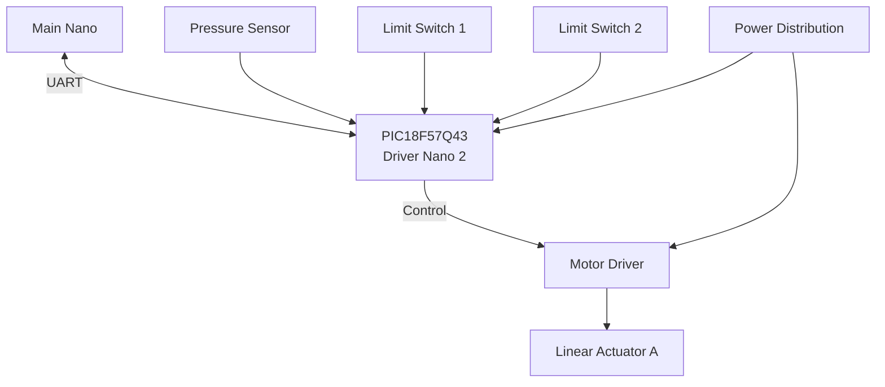

# Schematic Design

## Overview

This page documents the electrical schematic development for my assigned subsystem, Driver Nano 2.

The subsystem uses a PIC18F57Q43 Curiosity Nano to control Linear Actuator A, read the pressure sensor, monitor limit switches, and communicate with the main controller.

The individual schematic has not yet been completed.

## Schematic Design Objectives

The completed schematic must show:

- PIC18F57Q43 Curiosity Nano connections
- UART communication connections
- Linear actuator motor-driver interface
- Pressure sensor connections
- Two limit-switch inputs
- Logic power and actuator power
- Ground connections
- Required electrical protection
- Component reference designators

## Proposed Electrical Architecture

*Figure 1. Proposed subsystem connections. This is a functional diagram, not a completed electrical schematic.*

## Microcontroller Connections

The PIC18F57Q43 Curiosity Nano will provide the input, output, and communication functions for my subsystem.

| Connection | Intended Function |
|---|---|
| UART TX | Send feedback to the main controller |
| UART RX | Receive commands from the main controller |
| Digital outputs | Control motor-driver functions |
| Digital inputs | Read limit switches |
| Analog or digital sensor input | Read pressure sensor |
| Power and ground | Supply the controller |

Exact pins will be assigned after confirming peripheral configuration and electrical compatibility.

## Actuator Driver Circuit

The PIC cannot directly supply the operating power required by a typical linear actuator motor.

The schematic will include a suitable motor driver between the PIC and Linear Actuator A.

The final driver connections depend on:

- Actuator operating voltage
- Running and startup current
- Driver control interface
- Required direction control
- Stopping behavior
- Electrical protection

The driver must be selected before its final schematic connections can be completed.

## Pressure Sensor Circuit

The pressure sensor will provide contact or pressure information to the controller.

If the selected sensor has an analog output, the design must ensure that its output voltage is compatible with the PIC input.

Any required filtering, amplification, or other signal conditioning will be determined from the sensor datasheet.

## Limit-Switch Circuit

Two limit switches are planned for the assigned joint.

The switches will provide signals indicating the ends of the permitted movement range.

The final design will specify the switch contact configuration, input biasing, and fault behavior.

The software is intended to prevent further movement into an active limit.

## UART Communication Circuit

UART is the selected communication method between the team controllers.

My schematic must identify the correct transmit, receive, and ground or reference connections.

The final wiring arrangement and electrical interface will be coordinated with the main controller design.

## Power Distribution

The schematic will separate the low-power controller supply from the actuator's motor-power requirements.

Power regulation, protection, and grounding must be designed using the selected components' specifications.

The final supply voltages and current ratings are not yet confirmed.

## Schematic Development Status

| Task | Status |
|---|---|
| Identify subsystem responsibilities | Completed |
| Select PIC18F57Q43 Curiosity Nano | Completed |
| Identify functional connections | Planned |
| Confirm actuator model | Pending |
| Confirm motor driver | Pending |
| Confirm pressure sensor | Pending |
| Assign PIC pins | Pending |
| Draw complete schematic | Not started |
| Perform electrical review | Pending |
| Export schematic PDF | Pending |
| Export source project | Pending |

## Required Deliverables

Once the schematic is complete, this page will include:

1. An image of the full electrical schematic.
2. A downloadable PDF of the schematic.
3. A ZIP containing the editable schematic project files.
4. A short explanation of the major circuit sections.
5. A list of verified electrical design decisions.

## Conclusion

The Driver Nano 2 electrical architecture has been outlined, but the detailed schematic is still in development.

The next step is to confirm the actuator and driver specifications, then create the circuit using the selected schematic editor.
